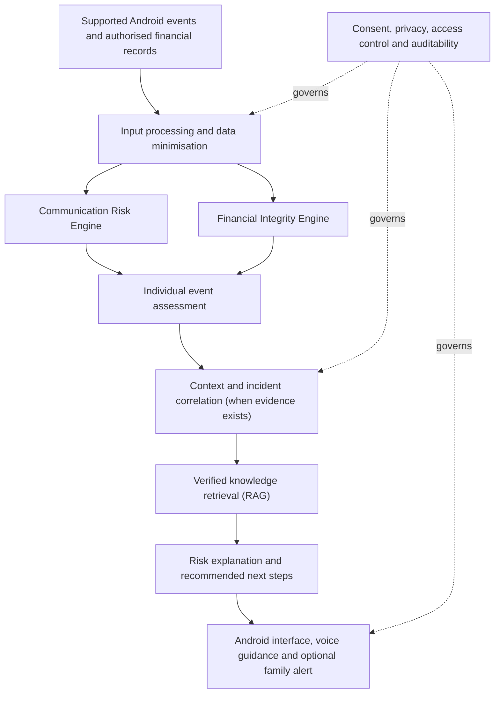

# SOUL

**A privacy-first digital and financial safety intelligence assistant.**

SOUL is a proposed Android-first assistant intended to help people—especially elderly and less technically confident smartphone users—recognise suspicious digital activity, understand the evidence, and take safer next steps.

> **Project status: Milestone 2 — first text-only ML baseline trained and evaluated**
>
> Repository and backend foundations are complete. A Mendeley 2022 SMS candidate has been structurally inspected and processed into a local, redacted development derivative. Exact-text label conflicts are quarantined; a deterministic 70/15/15 grouped split has been generated locally. The first TF-IDF + Logistic Regression baseline has been trained and evaluated: validation macro-F1 0.8682; initial test macro-F1 0.8915. The full local test suite has passed 45 tests after adding label-provenance validation (45 passed in 5.25s); the new blinded-review queue tests are pending their first local run. These are exploratory results on this dataset, not real-world fraud-detection accuracy. Source/privacy approval and external campaign-independent validation remain pending. The data-preparation code now preserves original source labels separately from future SOUL-reviewed labels; this revised preparation and validator passed locally (45 passed in 5.25s). A blinded validation-error review queue and 12 additional tests have since been added and await local verification; financial-integrity, RAG and Android features are not yet implemented.

## The problem

Digital fraud does not happen through one channel alone. People may encounter suspicious SMS messages, app notifications, links, QR codes, fake payment screenshots, impersonation attempts, or unexpected changes in their financial records.

Many tools inspect one item at a time. SOUL aims to combine:

1. **Proactive detection where Android makes the data available and the user has granted the required permission.**
2. **Individual risk analysis**, so one suspicious message or transaction can be investigated on its own.
3. **Contextual intelligence**, which can connect multiple events only when the available evidence supports a relationship.
4. **Clear and accessible guidance**, including simple Hindi/Hinglish explanations and verified safety instructions.
5. **Privacy and user control**, rather than unrestricted collection of personal data.

## What SOUL is intended to do

### 1. Communication risk detection

Analyse supported digital signals such as:

- Suspicious SMS or notification text.
- URLs and potentially phishing websites.
- QR-code destinations.
- User-provided screenshots or images through supported workflows.

Each item should be assessed independently first. A single suspicious item can be enough to create a case and trigger a warning.

### 2. Context and incident intelligence

An *incident* is simply a case SOUL is investigating. It may contain only one suspicious event or several related events.

When multiple events exist, SOUL may compare identifiers and context—such as a domain, sender, phone number, UPI ID, claimed organisation, or event timing—to determine whether there is evidence that they are connected.

A shared name or keyword alone is not proof of a connection. SOUL should show why it linked evidence and preserve uncertainty when the relationship is unclear.

### 3. Financial account integrity monitoring

SOUL is also intended to help users notice unexpected changes in financial records, such as:

- Unrecognised debits or credits.
- Unexpected changes in balances.
- Fixed-deposit closure or maturity discrepancies.
- Other unusual changes visible in records the user has authorised SOUL to process.

The initial prototype will use synthetic records and/or user-provided sample statements. Live bank or Account Aggregator integrations are future work and must use authorised, consent-based access. SOUL cannot inspect a bank's internal Core Banking System or prove employee misconduct from customer-side records.

### 4. Verified safety guidance with RAG

A Retrieval-Augmented Generation (RAG) component is planned to retrieve relevant information from traceable, trusted sources—such as official regulator, bank, telecom and cybersecurity guidance.

The detection engine decides what signals are suspicious. RAG supplies relevant knowledge and procedures; it does not independently prove that fraud occurred.

### 5. Voice-first, accessible assistance

The intended experience includes simple Hindi/Hinglish explanations, voice output, clear warnings, and optional trusted-family escalation with the user's consent.


## Dataset and first baseline

The repository contains the documented three-class schema, annotation guide, 24-row and 84-row synthetic development sets, and local-only scripts for auditing and preparing a Mendeley 2022 SMS candidate. The local prepared derivative contains 5,797 records before final masked-text grouping; 68 exact-text conflict rows are quarantined. The deterministic split contains 4,004 training, 856 validation and 861 test rows. The split is grouped by identical final masked text, not by near-duplicate campaign, so results will be exploratory only.

The raw third-party archive, prepared messages, split CSVs and model artefacts are kept under Git-ignored `data/raw/` and `data/private/`; they are not committed. The candidate's licence and source are documented in [data/source_review.md](data/source_review.md), but this does not itself approve redistribution or establish that the data is anonymous.

The first text-only TF-IDF + Logistic Regression implementation is in [data/train_text_baseline.py](data/train_text_baseline.py), with its fixed recipe, initial validation/test metrics and limitations in [data/model_baseline.md](data/model_baseline.md). The model and aggregate metrics are stored locally under Git-ignored `data/private/model_artifacts/`; they are not committed. The full backend test suite last passed 45 tests (45 passed in 5.25s). A new blinded validation-review queue and its 12 tests have since been added and await local verification. The synthetic CSV validator remains available via `python data/validate_dataset.py`.

See [data/dataset_schema.md](data/dataset_schema.md), [data/annotation_guide.md](data/annotation_guide.md), [data/source_review.md](data/source_review.md), [data/split_strategy.md](data/split_strategy.md) and [data/model_baseline.md](data/model_baseline.md).

## Current backend starter

The first backend increment includes a FastAPI application, environment-based configuration, a GET /health endpoint, one automated test, pinned direct dependencies and a placeholder .env.example.

Follow [backend/README.md](backend/README.md) to recreate the local Python environment, start the API and run tests. The first local verification has passed; repeat these steps on a new setup.

## Proposed architecture



See [docs/ARCHITECTURE.md](docs/ARCHITECTURE.md) for design details and implementation boundaries.

## Planned technology stack

The stack below is a **proposal**. Tools will be introduced only when the relevant milestone begins.

| Area | Planned technology | Intended role |
|---|---|---|
| Android | Kotlin, Android SDK, Jetpack Compose | Mobile application and supported device integrations |
| Backend | Python, FastAPI | API layer and orchestration |
| Classical ML | Scikit-learn | Baseline message classifier |
| NLP | Hugging Face Transformers | Multilingual text classification experiments |
| Image / QR | ML Kit and/or OpenCV | Supported OCR, image and QR processing |
| Correlation | NetworkX initially | Explainable entity and event relationships |
| Database | PostgreSQL | Incidents, evidence metadata and analysis results |
| RAG retrieval | PostgreSQL full-text search + pgvector | Keyword and vector retrieval over verified documents |
| Voice | Android Text-to-Speech; speech input evaluated separately | Accessible voice interaction |
| Testing | Pytest and Android tests | Automated checks and regression tests |

## Important scope and safety boundaries

SOUL is a defensive assistant, not a bank, antivirus replacement, law-enforcement system, or guarantee against fraud.

- Android does not provide unrestricted access to every other app's private content. Automatic monitoring must use supported APIs, user-granted permissions and applicable platform policies.
- User-initiated sharing or import is a fallback when automatic access is unavailable—not a reason to request excessive permissions.
- Bank statements, notifications and other customer-side records can reveal anomalies, but cannot expose all internal bank activity. SOUL must not claim to detect internal staff credential misuse without authorised bank-side evidence.
- A screenshot is not proof that a payment succeeded. The bank or payment provider's authorised record is the source of truth.
- A suspicious indicator is not proof of fraud. Risk explanations must communicate uncertainty and avoid unsupported accusations.
- Do not commit real personal messages, bank statements, account numbers, phone numbers, credentials, API keys or other sensitive information. Use synthetic or properly anonymised examples.
- No financial transaction, account change, or message is to be executed automatically by SOUL.

## Development roadmap

1. **Project foundation:** documentation, repository structure and development environment.
2. **Backend foundation:** FastAPI application, configuration, health endpoint and tests.
3. **Data and baseline detection:** curated/synthetic examples, preprocessing and a baseline classifier.
4. **Evidence processing:** supported URL, QR and image workflows.
5. **Incident intelligence:** entity extraction, explainable correlation and case history.
6. **Financial integrity prototype:** synthetic statement and FD-record analysis.
7. **RAG:** verified document ingestion, retrieval, citations and abstention.
8. **Android integration:** user interface, supported monitoring, voice guidance and permissions.
9. **Evaluation:** compare baselines, measure false positives, test privacy and usability, and document limitations.

Track detailed work in [docs/ROADMAP.md](docs/ROADMAP.md).

## Current repository structure

```text
SOUL/
├── README.md
├── .gitignore
├── docs/
│   ├── ARCHITECTURE.md
│   ├── ROADMAP.md
│   └── LEARNING_NOTES.md
├── backend/
├── ml/
├── rag/
├── android/
└── research/
```

Folders for implementation will be added as their milestones begin.

## Learning and contribution approach

This is also a learning project. Each module should include:

- A simple explanation of the problem and design.
- Small, understandable implementation steps.
- Tests or a reproducible manual test.
- Notes on limitations and security.
- Short Hinglish revision notes and likely viva questions.

See [docs/LEARNING_NOTES.md](docs/LEARNING_NOTES.md).

## Disclaimer

SOUL is an educational project and prototype under development. It must not be relied on as the sole basis for financial or security decisions. Users should verify suspicious activity directly through official bank, telecom or government channels.
